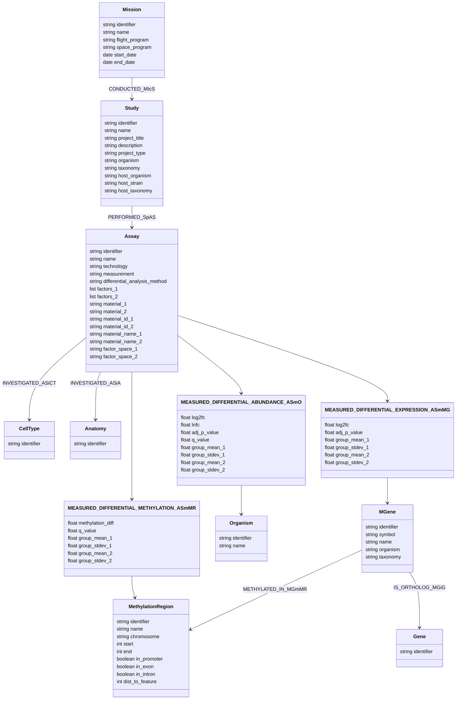

Visualize the KG schema using a Mermaid class diagram

Now let me get the relationship edge properties (for the edges with data like log2fc, adj_p_value).

Now I'll build the draft diagram and run it through the required cleaning step.

Now saving the cleaned diagram as a `.mermaid` file and presenting it.

Here's the GeneLab KG schema as a Mermaid class diagram:

This maps the full backbone we've been querying: **Mission → Study → Assay**, with Assay branching out to three measurement types (expression → MGene, methylation → MethylationRegion, abundance → Organism) via intermediary relationship classes that carry the statistics (log2fc, adj_p_value, q_value, etc.). MGene also links to MethylationRegion directly (for the promoter-overlap analyses we ran on OSD-48) and to Gene via ortholog mapping. The **genelab-kg-schema** file has the raw diagram code if you want to render or edit it elsewhere.